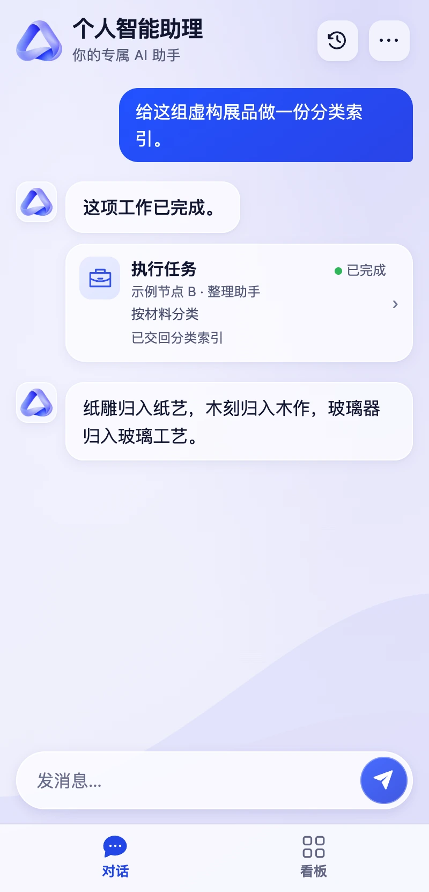

<p align="center"></p>

# Asterhelm · Personal Super Agent

**[访问 Asterhelm 项目主页](https://whw2808.github.io/asterhelm/)**

**Asterhelm（星舵）是一个可自托管的 Personal Super Agent。** 你在同一场对话里交代目标、调整范围、收取结果。星舵记得你的偏好和未完事项，按任务需要调度已接入的设备和 Agent。每次派单都有记录，你能看到谁接了单、处理了多久，以及交回了什么。

Talk to Asterhelm in one place. It delegates to agents on your devices, follows up on your schedule, and brings results back to the same conversation. When it spots unfinished work in a source you have chosen to follow, it can check the evidence and ask whether you want it to take the work on.

**设计来源**　Asterhelm 的调度设计参考了 DeepSeek Harness（DSH）团队的 Super Agent 研究原型。其中，Router 负责对话和派单，Worker 执行任务并回报。星舵把这种分工用在个人的多设备、多 Agent 协作中。[DSH Super Agent 研究原型](https://github.com/deepseek-ai/dsh-superagent-prototype)

<p align="center"> &nbsp; </p>

## 星舵怎样跟进一件事

- **发现待办。** 你让星舵关注的会话提到展品目录缺了一张清单时，星舵可以请来源设备上的 Agent 在隔离环境里只读查证。同一候选事项最多自动查证一次。你可以查看依据、忽略建议，或明确要求再查一次。
- **确认后接手。** 候选卡列出目标、交付条件和下一步。你明确同意后，星舵才为候选建立工作编号，或将它归入已有工作。此后，手机上的修改、各设备的分工和交付都沿用同一编号。例如，“暂停电子版，纸本继续”只调整相关分工，任务卡会区分已请求撤回和执行端已确认停止。
- **回到原桌面会话。** 选择参与工作的 Codex 会话并启用回执后，原窗口会收到工作摘要并确认收悉。你在该窗口说“继续”，它才按最新范围接着做，新的桌面回复也会回到手机主聊天。
- **约定何时跟进。** 可以交代“每个工作日上午九点提醒我”，也可以说“每次目录校对失败都提醒我”。规则保存在自托管主机上，手机离线时仍可触发，重连后可在原聊天补看和暂停。对于“持续核对纸本目录，直到两册都核对完”，星舵按新回执或下次检查时间继续，达到约定的交付条件后结束。

想知道总控用了多少 token，可以在主聊天问“星舵今天用了多少 token？”，也可以打开**看板 → Token 用量**。看板按今日和累计分别列出总控的输入、输出和合计。累计值从启用统计时算起，仅汇总模型服务实际返回的用量，并标出上报不完整的调用次数。

## 先跑通一次本地派单

在 macOS 或 Linux 上安装 Node.js 24 和 Python 3。以下示例使用离线 Worker 统计输入字节，不需要模型账号。先克隆仓库，在项目根目录初始化本地服务。

```sh
git clone https://github.com/whw2808/asterhelm.git
cd asterhelm
node scripts/asterhelm.mjs init
node scripts/asterhelm.mjs configure-worker --adapter check
node scripts/asterhelm.mjs hub
```

在第二个终端进入同一目录，启动 Worker。

```sh
node scripts/asterhelm.mjs worker hub.check
```

在第三个终端派单，然后用返回的任务 ID 查询结果。

```sh
node server/control.mjs submit hub.check 'Hello'
node server/control.mjs get TASK_ID
```

将 `TASK_ID` 替换为实际 ID。任务完成后，可以看到 `succeeded` 和字节数。若要使用自然语言派单，还需配置规划模型，并接入已在工作机上完成授权的 Codex 或 DeepSeek Harness。部署步骤见 [自托管指南](docs/self-hosting.md)。

## 一次派单如何完成

| 组件 | 职责 |
| --- | --- |
| 手机与浏览器 | 使用同一套对话和看板。安卓客户端支持配对和系统通知。 |
| 个人助手 | 记录偏好和未完成事项，按需检索上下文，选择目标 Agent，并把任务结果整合到原对话。 |
| Broker | 维护设备和 Agent 注册信息、能力、任务状态及执行回执。 |
| Worker | 在所属设备上领取任务，按配置的执行权限工作。远程 Worker 使用双向 TLS 连接 Broker。 |

已有 Codex Desktop 会话可以选择性接入。启用前请查看自托管指南，了解会同步哪些数据，以及怎样限制工作区写权限。手机端需要你自己的 HTTPS 地址。安卓提醒通过前台服务维持连接，送达会受到系统后台策略影响。

## 使用与维护

- [自托管指南](docs/self-hosting.md) · 部署服务端、接入模型、建立设备信任与手机配对
- [Android 构建指南](android/README.md) · 为自己的服务地址构建和安装客户端
- [展示页源码](docs/showcase/index.html)
- [贡献流程](CONTRIBUTING.md) · Issue、分支、Pull Request 和版本发布
- [版本记录](CHANGELOG.md) · [GitHub Releases](https://github.com/whw2808/asterhelm/releases)
- [MIT 许可证](LICENSE) · [第三方许可](THIRD_PARTY.md) · [安全问题反馈](SECURITY.md)
