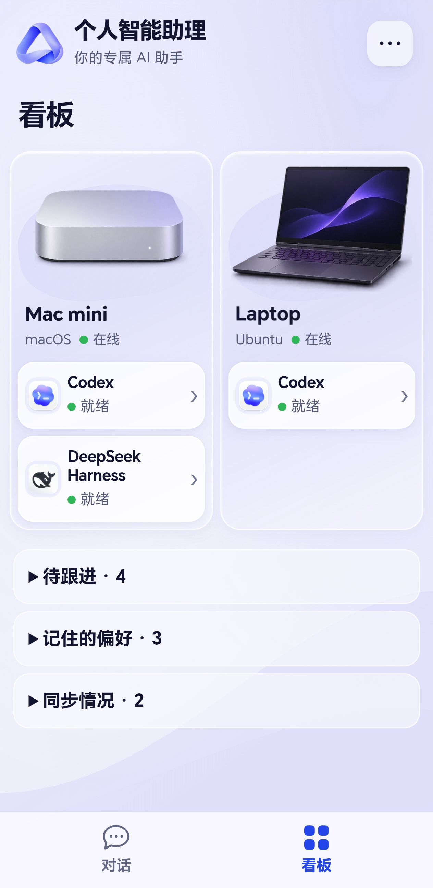

<p align="center"></p>

# Asterhelm · Personal Super Agent

**[访问 Asterhelm 项目主页](https://whw2808.github.io/asterhelm/)**

**Asterhelm（星舵）是一个可自托管的 Personal Super Agent。** 你只和星舵对话。它记得你的偏好和未完事项，结合已接入的会话，选出合适的设备和 Agent 来处理任务。即使只是查证一条信息，你也能在原对话里看到谁在处理、进展如何、用了多久，并在这里收到结果。到了约定的时间，或关注的会话有了变化，星舵会主动提醒你。

Talk to Asterhelm in one place. It remembers your preferences and unfinished work, delegates tasks to the agents on your devices, and brings the results back to the conversation.

**设计来源**　Asterhelm 的调度设计参考了 DeepSeek Harness（DSH）团队的 Super Agent 研究原型。其中，Router 负责对话和派单，Worker 执行任务并回报。星舵把这种分工用在个人的多设备、多 Agent 协作中。[DSH Super Agent 研究原型](https://github.com/deepseek-ai/dsh-superagent-prototype)

<p align="center"> &nbsp; </p>

## 先跑通一次本地派单

在 macOS 或 Linux 上安装 Node.js 24 和 Python 3。以下示例使用离线 Worker 统计输入字节，不需要模型账号。先克隆仓库，在项目根目录初始化本地服务。

```sh
git clone https://github.com/whw2808/asterhelm.git
cd asterhelm
node scripts/asterhelm.mjs init
node scripts/asterhelm.mjs configure-worker --adapter check
node scripts/asterhelm.mjs hub
```

在第二个终端进入同一目录，启动 Worker。

```sh
node scripts/asterhelm.mjs worker hub.check
```

在第三个终端派单，然后用返回的任务 ID 查询结果。

```sh
node server/control.mjs submit hub.check 'Hello'
node server/control.mjs get TASK_ID
```

将 `TASK_ID` 替换为实际 ID。任务完成后，可以看到 `succeeded` 和字节数。若要使用自然语言派单，还需配置规划模型，并接入已在工作机上完成授权的 Codex 或 DeepSeek Harness。部署步骤见 [自托管指南](docs/self-hosting.md)。

## 一次派单如何完成

| 组件 | 职责 |
| --- | --- |
| 手机与浏览器 | 使用同一套对话和看板。安卓客户端支持配对和系统通知。 |
| 个人助手 | 记录偏好和未完成事项，按需检索上下文，选择目标 Agent，并把任务结果整合到原对话。 |
| Broker | 维护设备和 Agent 注册信息、能力、任务状态及执行回执。 |
| Worker | 在所属设备上领取任务，按配置的执行权限工作。远程 Worker 使用双向 TLS 连接 Broker。 |

已有 Codex Desktop 会话可以选择性接入。启用前请查看自托管指南，了解会同步哪些数据，以及怎样限制工作区写权限。手机端需要你自己的 HTTPS 地址。安卓提醒通过前台服务维持连接，送达会受到系统后台策略影响。

## 使用与维护

- [自托管指南](docs/self-hosting.md) · 部署服务端、接入模型、建立设备信任与手机配对
- [Android 构建指南](android/README.md) · 为自己的服务地址构建和安装客户端
- [展示页源码](docs/showcase/index.html)
- [贡献流程](CONTRIBUTING.md) · Issue、分支、Pull Request 和版本发布
- [版本记录](CHANGELOG.md) · [GitHub Releases](https://github.com/whw2808/asterhelm/releases)
- [MIT 许可证](LICENSE) · [第三方许可](THIRD_PARTY.md) · [安全问题反馈](SECURITY.md)
